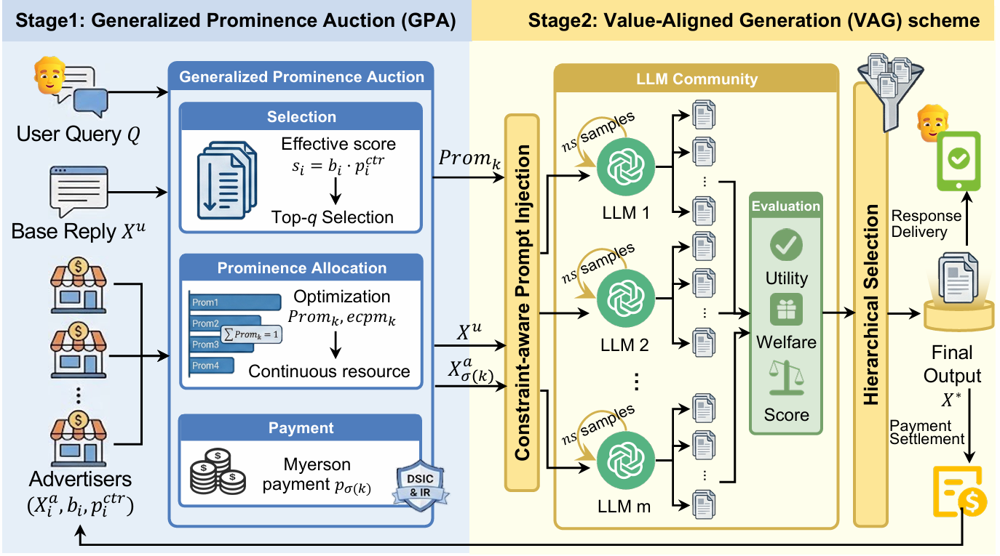

<!-- markdownlint-disable MD033 -->
<h1 align="center">
  One Answer, Multiple Ads<br>
  Auction-Guided Advertising in LLM Responses
</h1>
<!-- markdownlint-enable MD033 -->

**MAE-AM** uses auctions to allocate advertising word-length budgets and embed multiple ads into a single LLM response. Rather than selecting only one advertisement, it distributes the available advertising space among competing advertisers and incorporates their content into a query-conditioned answer.

The framework connects auction-based allocation with response generation, enabling the study of advertiser utility and response quality across different auction mechanisms.



## 🚀 Quick Start

### 1. Install dependencies

```bash
python -m pip install -r requirements-experiments.txt -r requirements-backbones.txt -r requirements-scoring.txt
```

### 2. Configure

Set environment variables for the adapters you enable.

| Adapter | API key environment variable |
| --- | --- |
| ChatGPT | `OPENAI_API_KEY` |
| claude | `CLAUDE_API_KEY` |
| kimi | `MOONSHOT_API_KEY` |
| GLM | `ZHIPUAI_API_KEY` |
| ernie | `QIANFAN_API_KEY` |
| Qwen | `DASHSCOPE_API_KEY` |

Model IDs and endpoints can be configured with `MAE_AM_<ADAPTER_UPPERCASE>_MODEL_ID` and `MAE_AM_<ADAPTER_UPPERCASE>_BASE_URL`. Claude requires an explicit Claude 4 model ID and an OpenAI-compatible endpoint providing it. Qwen requires an explicit Qwen3 model ID. Supported IDs are defined in `utils/backbones.py`.

LERA additionally requires an SGLang service configured through `MAE_AM_LERA_BASE_URL` and `MAE_AM_LERA_MODEL_ID`. Set `MAE_AM_LERA_API_KEY` if the service requires authentication. Semantic scoring uses BGE-M3 locally.

Edit queries and budgets in `cfgs/`. Dataset links, input locations, and schemas are listed in [dataset/DOWNLOAD.txt](dataset/DOWNLOAD.txt). ADGEN uses preprocessed JSON files under `dataset/ADGEN/{jacket,skirt,trousers}/`. ATVI reads `dataset/ATVI/ad_data.xlsx`. ADGEN lengths are counted in characters and ATVI lengths in whitespace-separated words.

### 3. Run experiments

```bash
python run_paired_experiments.py prepare --output outputs/paper --profile paper
python run_paired_experiments.py run --manifest outputs/paper/manifest.json
```

The paper profile uses six candidate models, enumerative format, 20 advertisers per instance, and five repetitions. LLM-based methods generate five candidates per model. GA directly inserts source-advertisement prefixes. Each model is scored by its candidate mean, and the selected model supplies its best sample.

Methods (CLI names): `Prom` (MAE-AM), `GSP`, `GA`, `ALS`, `AAL`, `SQA`, `PA-AIGC`, `LERA`. To select categories, add e.g. `--categories ADGEN/jacket ATVI/Food` to `prepare`. To run selected methods, add e.g. `--methods Prom GSP GA` to `run` and use the same selection for aggregation. Use a new output directory for a different configuration.

### 4. Aggregate results

JSON results are saved beneath the output directory in `result_<MECHANISM>/<INSTANCE_ID>/` (`ALS` → `Prom_ALS`, `AAL` → `Prom_AAL`, `SQA` → `GSP_SQA`, `PA-AIGC` → `PA_AIGC`).

```bash
python run_paired_experiments.py aggregate --manifest outputs/paper/manifest.json
```

Aggregation writes `summary.json` and `length_summary.json` beside the manifest. Economic and semantic metrics are averaged within each repetition and then arithmetically across the five repetitions. Dataset-specific results are under `per_dataset`. Length statistics report Bias, MAE, pooled NMAE, and Pearson correlation from recorded advertisement spans.

A fixed seed controls local sampling, not provider-side generation.

## 📚 Citation

If you use this work, please cite:

```bibtex
@unpublished{anonymous2027oneanswer,
  title  = {One Answer, Multiple Ads: Auction-Guided Advertising in {LLM} Responses},
  author = {Anonymous},
  note   = {Under review at The ACM Web Conference 2027 (WWW '27)}
}
```
